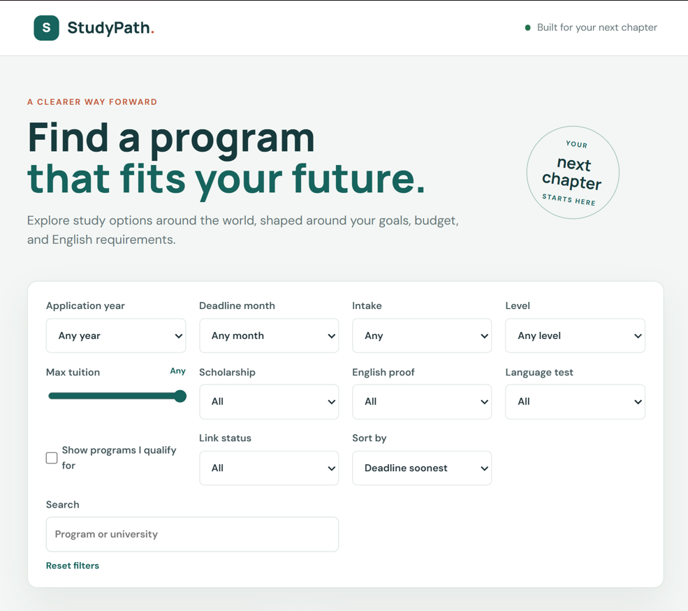
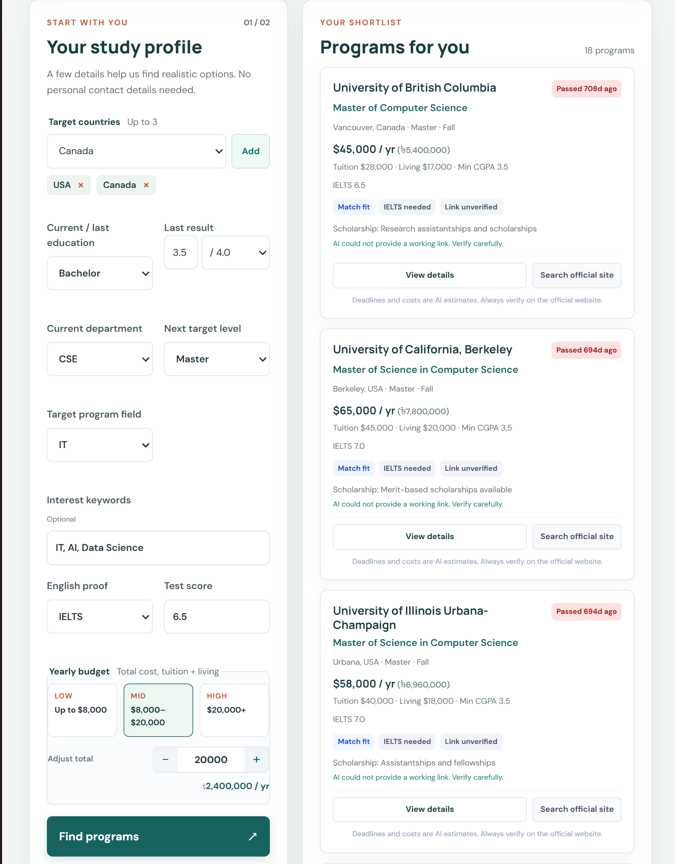

<div align="center">

# StudyPath

**Find a program that fits your future.**

An AI-assisted study abroad program finder shaped around your goals, budget, and English requirements.

[Getting Started](#getting-started) · [Features](#features) · [How It Works](#how-it-works) · [Deployment](#deploy-to-vercel)

</div>

---



## Overview

StudyPath helps students explore study options around the world. Describe your academic background, target countries, English proficiency, and yearly budget, and the app builds a shortlist of realistic programs for you, complete with estimated tuition, living costs, deadlines, and scholarship information.

No personal contact details are required.



## Features

- **Personalized study profile**: choose up to 3 target countries, then set your current education, GPA, department, next target level, field, and interest keywords.
- **Budget-aware matching**: pick a Low, Mid, or High yearly budget, or fine-tune the exact total (tuition + living costs).
- **English proof matching**: enter your test type and score to see only programs you qualify for.
- **Rich filtering**: narrow results by application year, deadline month, intake, level, max tuition, scholarship availability, English proof, language test, and link status.
- **Flexible sorting and search**: sort by soonest deadline and search by program or university name.
- **Clear program cards**: each result shows yearly cost, tuition and living breakdown, minimum CGPA, IELTS requirement, scholarship notes, and status badges such as *Match fit*, *IELTS needed*, and *Link unverified*.
- **Local currency conversion**: costs are shown alongside an estimate in your local currency.
- **Built-in verification prompts**: every card links to a "Search official site" action, and deadlines and costs are clearly marked as AI estimates.

## How It Works

1. You fill in your study profile and click **Find programs**.
2. The server sends **one Gemini request per uncached search** and returns a structured shortlist.
3. Filtering, sorting, search, and program details all run **in your browser**, so refining results is instant and costs no extra API calls.

The Gemini API key stays on the server and is never exposed to the client.

> **Important:** Deadlines, tuition, and requirements are AI-generated estimates. Always verify them on the official university website before applying.

## Getting Started

### Prerequisites

- [Node.js](https://nodejs.org/) (LTS recommended)
- A free Gemini API key from [Google AI Studio](https://aistudio.google.com/apikey)

### Installation

1. **Get an API key** at https://aistudio.google.com/apikey.

2. **Configure your environment.** Copy `.env.example` to `.env` in the project folder and set your key:

   ```bash
   cp .env.example .env
   ```

   ```env
   GEMINI_API_KEY=your_api_key_here
   ```

3. **Install dependencies and start the app:**

   ```bash
   npm install
   npm start
   ```

4. **Open** http://localhost:3000.

## Deploy to Vercel

1. Import this repository into [Vercel](https://vercel.com/).
2. Add `GEMINI_API_KEY` under **Project Settings → Environment Variables**.
3. Deploy. The Express app is routed through the Node.js function defined in `vercel.json`.

## Security

- Never commit your `.env` file. Configure the key in Vercel's environment variables for production.
- Never add the API key to `public/app.js` or any other client-side file.

## Disclaimer

StudyPath provides AI-generated estimates for planning purposes only. It is not an official admissions resource. Confirm all deadlines, costs, and entry requirements directly with each institution.
